# Video Chat

A private video call for two people, with a shared drawing board and a chat that takes markdown syntax. Open the page, send the link, talk. There is no account to create and nothing to install: it runs in the browser.

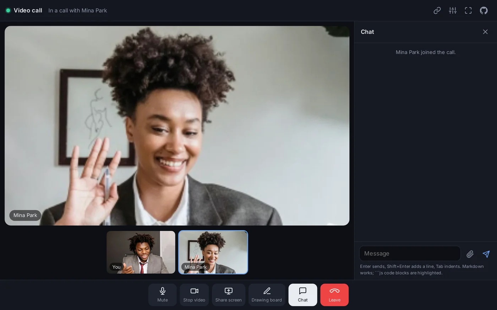

## Quick start

1. **Open the app.** Your camera preview appears, together with a link.
2. **Send the link** to the person you want to talk to. The Copy button puts it on your clipboard.
3. **They open the link and press Enter.** The call starts.

That is all. The rest of this manual explains each screen.

## The waiting room

Everyone starts in the waiting room.

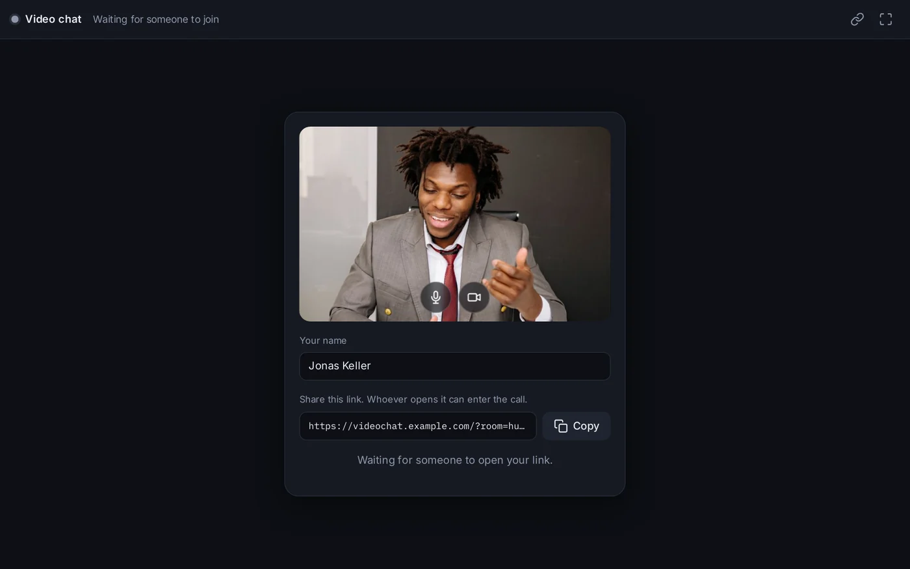

- **Your camera preview** shows what the other person will see. If the browser asks whether the page may use your camera and microphone, choose Allow.
- **The two round buttons** over the preview turn your microphone and your camera off or on before the call. A red button means off. You can change your mind at any time during the call.

  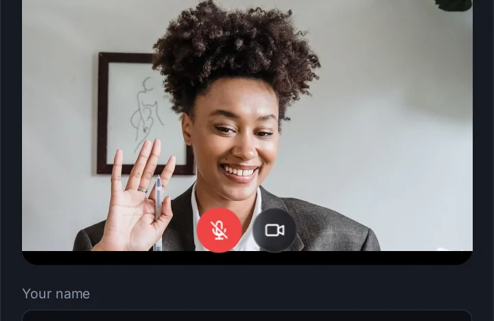
- **Your name** is what the other person sees under your video and in the chat. It is remembered on this device.
- **The link** is the invitation. Press **Copy** to copy it, then paste it into a message, an e-mail or wherever you like. On a phone there is also a **Share** button that opens the usual sharing menu.
- **The status line** at the bottom says what is happening: waiting for someone, connecting, or who has arrived.

The call starts by itself as soon as the other person enters. You do not have to accept anything.

### Arriving through a link

When you open someone's link, the waiting room looks almost the same, with an **Enter** button. Check your preview, turn your microphone or camera off if you want, then press Enter.

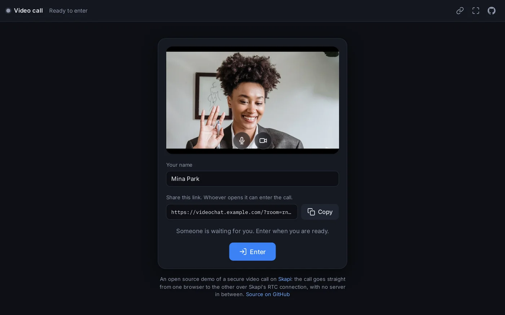

The status line tells you whether the other person is already there. If nobody is, press Enter anyway and wait; the call starts when they arrive.

<p align="center">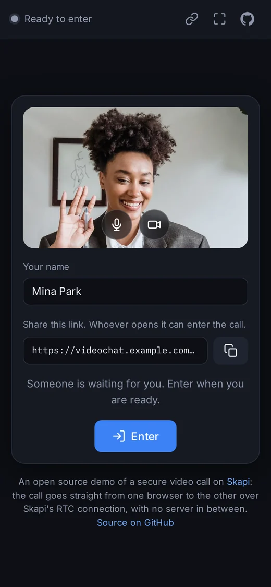</p>

## During the call


The large picture is the **stage**. Below it is a row of small pictures, one for each thing in the call: your camera, the other person's camera, a shared screen, the drawing board. **Click a small picture to put it on the stage.** The one on the stage has a blue outline.

A new screen share or the drawing board goes to the stage on its own, so you never miss what the other person wants to show you.

### The buttons at the bottom

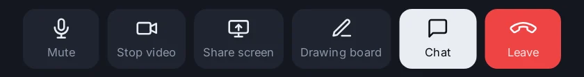

| Button | What it does |
| --- | --- |
| **Mute** / **Unmute** | Turns your microphone off or on. The other person sees a small crossed-out microphone on your picture while you are muted. |
| **Stop video** / **Start video** | Turns your camera off or on. While it is off the other person sees a dark picture with a camera icon instead of you. |
| **Share screen** / **Stop sharing** | Shows a window, a tab or your whole screen to the other person. See below. |
| **Drawing board** / **Close board** | Opens a shared drawing board for both of you. See below. |
| **Chat** | Opens and closes the chat. A red number on the button counts messages you have not read yet. |
| **Leave** | Ends the call. You go back to the waiting room and can call again. |

The top bar has three more buttons on the right: **copy the link** (to invite the other person again or from another device), **settings** (change your name) and **fullscreen**.

### If you cannot hear the other person

Some browsers do not play sound before you have touched the page. When that happens a blue **Tap to turn on sound** button appears at the top of the stage. Press it once.

## Sharing your screen

Press **Share screen**. The browser asks what to share: a window, a browser tab or the whole screen. Choose one and press Share. The other person sees it on their stage right away, and you see a small copy of it in your own row of pictures.

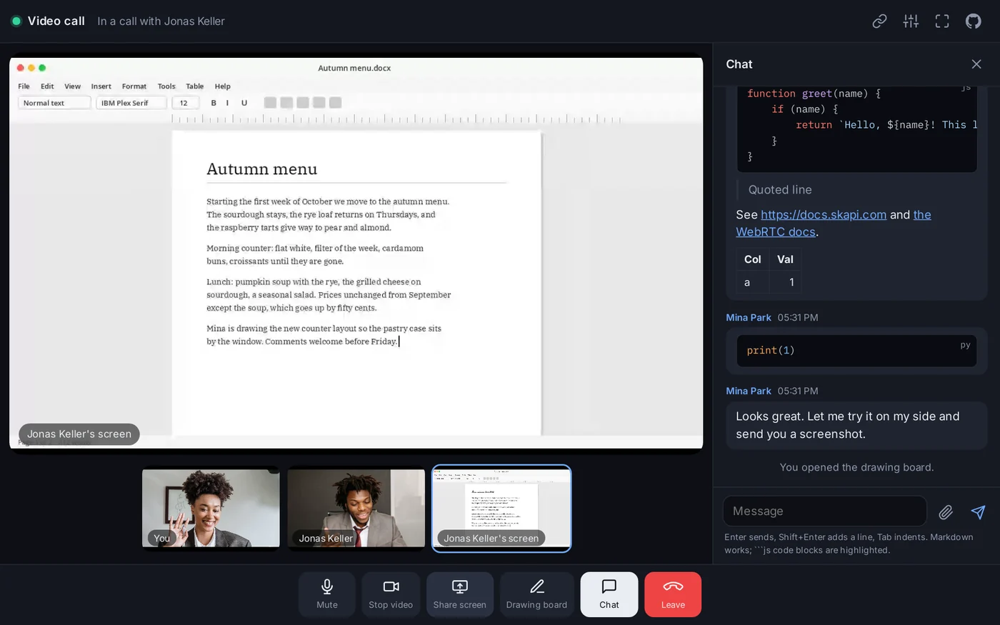

Press **Stop sharing** (the same button) to end it. The browser's own "Stop sharing" bar works too.

Screen sharing needs a desktop browser. On most phones and tablets the app says **This device does not support screen sharing.**

## The drawing board

Press **Drawing board**. A white board appears on the stage for both of you, and both of you can draw on it at the same time. Everything you draw shows up on the other side as you draw it.

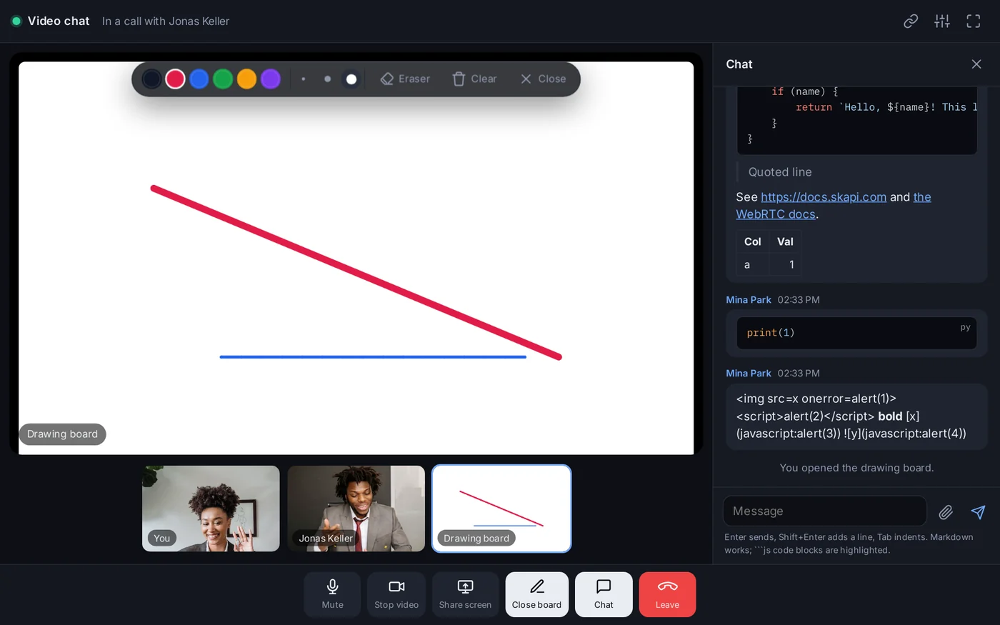

The tools float at the top of the board:

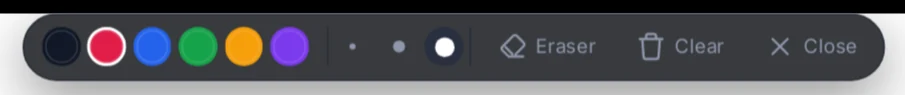

- **Colours**: six pens. The selected one has a white ring.
- **Sizes**: thin, medium and thick.
- **Eraser**: rubs out what is under the pointer. Press a colour to go back to drawing.
- **Clear**: wipes the whole board, for both of you.
- **Close**: takes the board away, for both of you. Opening it again brings back what was drawn.

The board stays open while you look at something else: click the other person's picture to see them, and click the board's small picture to come back. Drawing works with a mouse, a finger or a pen.

## Chat

Press **Chat** to open the chat beside the call. Messages go straight to the other browser and are not kept anywhere; when the call ends, the chat is gone.

**The chat takes markdown syntax.** Whatever you type is shown the way markdown renders it: `**bold**` becomes bold, `# Heading` becomes a heading, a line starting with `- ` becomes a bullet, a web address becomes a link, and code between ``` lines becomes a code block. Plain text stays plain text. The full list is under "Formatting" below.

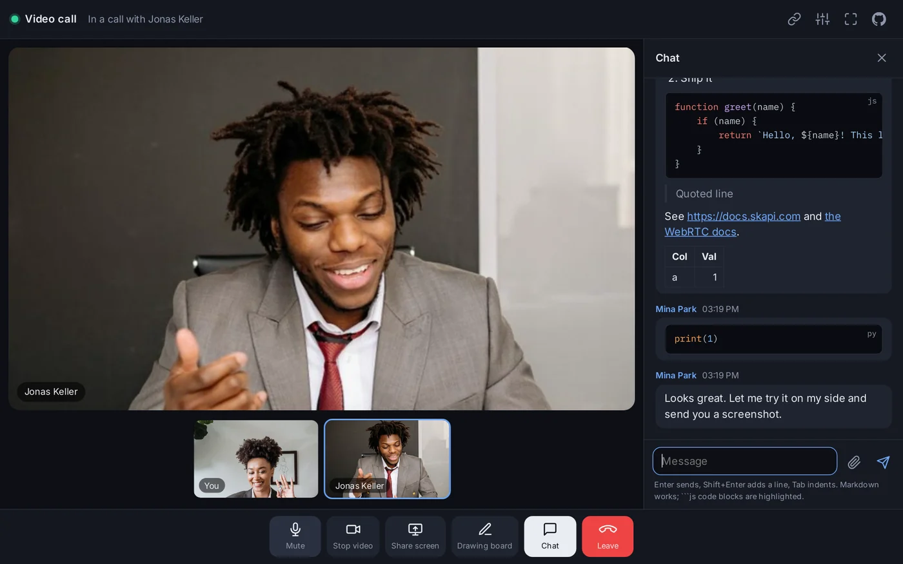

### Writing a message

Type in the box at the bottom. The box grows as you write.

| Key | What happens |
| --- | --- |
| **Enter** | Sends the message. |
| **Shift + Enter** | Starts a new line without sending. |
| **Tab** | Indents the line (or every selected line) by one step. |
| **Shift + Tab** | Removes one step of indentation. |

On a phone, the arrow button on the right sends.

### Formatting

These are the markdown marks the chat understands. Type the left column and the message shows the right column:

| Type this | You get |
| --- | --- |
| `**bold**` | **bold** |
| `*italic*` | *italic* |
| `~~crossed out~~` | ~~crossed out~~ |
| `` `code` `` | `code` in a monospace font |
| `# Heading` | a heading (`##` and `###` for smaller ones) |
| `- item` | a bullet list |
| `1. item` | a numbered list |
| `> quote` | a quoted line |
| `[text](https://example.com)` | a link called "text" |
| `https://example.com` | a link, as it is |
| `---` | a dividing line |

A table works too: write the cells between `|` characters, with a row of `---` under the first line.

### Code

Put code between two lines of three backticks and name the language after the first three:

<pre>
```js
function greet(name) {
    return `Hello, ${name}!`;
}
```
</pre>

The code keeps its indentation and never wraps: a long line scrolls sideways inside the message. Naming the language colours the code (`js`, `python`, `html`, `css`, `json`, `sql`, `bash` and many more). Hover over a code block and press **Copy** to copy the code.

While you write the lines of a code block, use **Shift + Enter** for each new line, and plain **Enter** when the block is done.

### Sending a file

Press the paperclip next to the message box and choose a file. It goes straight to the other person over the call, with a progress bar on both sides. They get a **Download** link, and pictures are shown right in the chat.

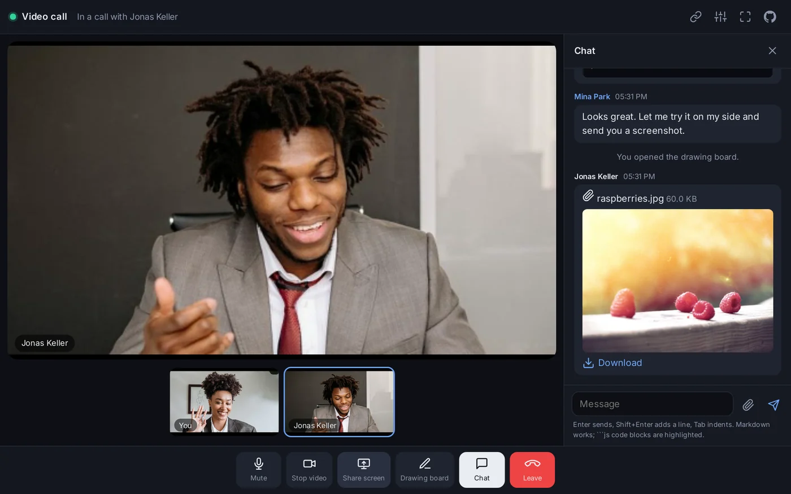

## Changing your name during the call

Press the **settings** button in the top bar (the sliders icon), type a new name and press Save. The other person sees the new name at once, and a line in the chat says who you are now.

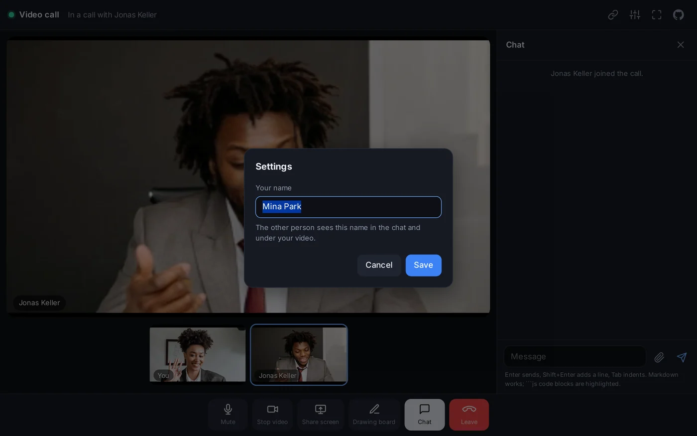

## When the other person is muted or has the camera off

A crossed-out microphone in the corner of their picture means they are muted. A dark picture with a camera icon means their camera is off.

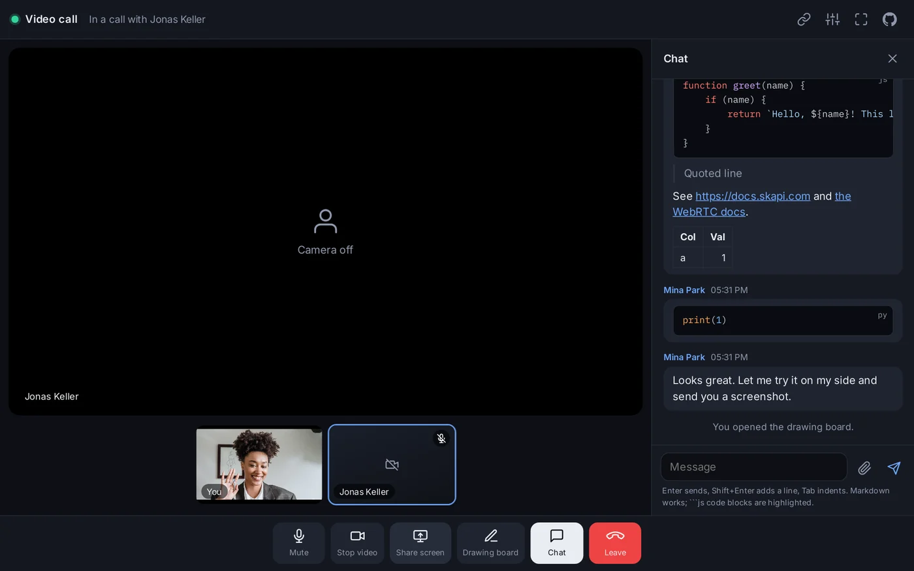

## On a phone

Everything works the same way on a phone, laid out for a small screen. The chat covers the call while it is open; press the X at the top to go back to the video. The control buttons show icons only.

<p align="center">
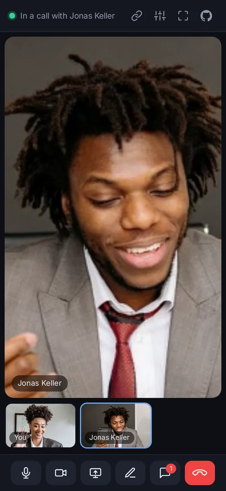
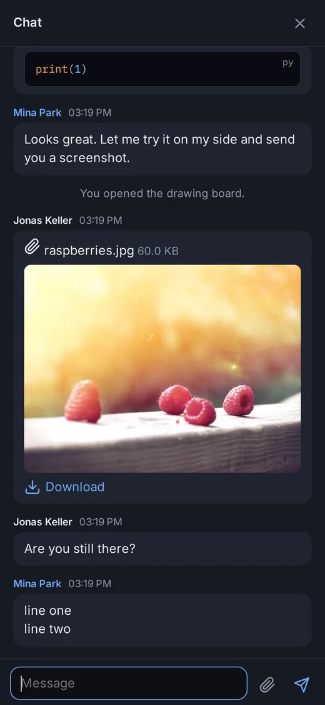
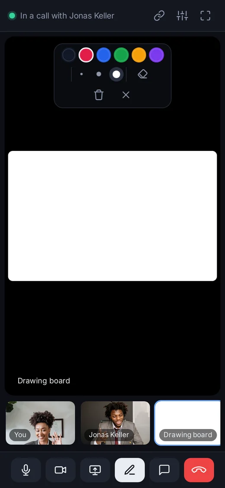
</p>

## Leaving and coming back

Press **Leave** to end the call. Both of you return to the waiting room. If the other person is still there, a **Call again** button starts a new call with them. The link keeps working: send it again, or open it on another device, and the next call starts the same way.

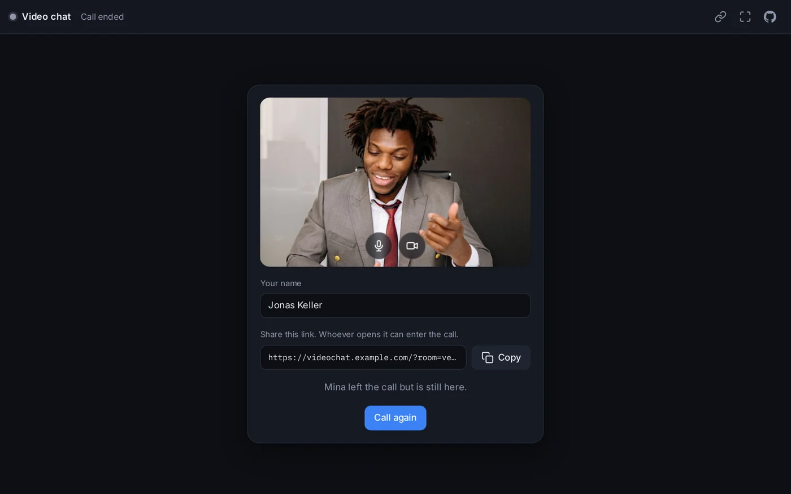

If your page reloads or the connection drops for a moment, the call comes back on its own once both browsers are in the room again.

## If something does not work

| What you see | What to do |
| --- | --- |
| **Camera blocked. Allow it in the address bar to be seen.** | The browser was told not to use the camera. Click the camera icon in the address bar, allow it, and reload the page. |
| **No camera** | The device has no camera or it is in use by another program. You can still take part with your microphone, and you still see the other person. |
| **Tap to turn on sound** | Press the button. The browser only plays sound after you have touched the page. |
| **This device does not support screen sharing.** | Phones and tablets cannot share their screen from a browser. Use a desktop browser for that. |
| **Two people are already in this call.** | A call is for two. Wait for one of them to leave, or ask for a new link. |
| The call does not start although both of you are in the waiting room | Make sure the page is open over **https://** or on `localhost`; browsers allow the camera and calls nowhere else. If you are testing on one computer, open the link in a **different browser or a private window**, not a second tab of the same browser. |
| **Anonymous login is turned off for this project.** | A message for whoever runs the site: see "Using your own project" below. |

## Privacy

Nobody signs up. When you open the page you get a temporary account that is deleted about half an hour after you leave. Your video, voice, chat messages, drawings and files travel directly between the two browsers and are not stored anywhere; the service behind the app only helps the two browsers find each other. Your name is kept on your own device, so you do not have to type it again.

---

# Running the app yourself

The app is open source and is made of four files with no build step, so it can be hosted anywhere that serves static files. It uses [Skapi](https://www.skapi.com) for the sign-in and for connecting the two browsers.

## Run it on your computer

You need [Node.js](https://nodejs.org). In the app's folder:

```sh
npm install
npm run dev
```

Then open `http://localhost:4000/`. Any other static file server works just as well; `npm run dev` is only a convenience.

Browsers allow the camera, the microphone, screen sharing and calls only on `localhost` or over **https://**. When you put the app on a server, serve it over HTTPS.

## Use your own project

The app comes set up with a demo project. To run it on a project of your own:

1. Create a free account at [www.skapi.com](https://www.skapi.com) and create a project.
2. Open the project's **Settings** and turn **Anonymous Login** on. This is what lets visitors in without an account. If it is off, the app shows "Anonymous login is turned off for this project."
3. Copy the project's **Project ID** from the project page.
4. Open `app.js` and replace the ID in this line near the top of the file:

   ```js
   const PROJECT_ID = "5VqfG6NuS163eFEcYy-7Zd6TgdLUaFxseKMT1qveY";
   ```

   For example:

   ```js
   const PROJECT_ID = "your-project-id";
   ```

That is the only change needed. Upload the folder to your web host (or to the hosting that comes with your Skapi project) and share the address.

## The files

| File | What it is |
| --- | --- |
| `index.html` | The page: the waiting room, the call, the chat and the dialogs. The icons are drawn in the file. |
| `style.css` | The look. Colours, sizes and fonts are variables at the top. |
| `app.js` | Everything the app does: the sign-in, the room and its link, the call, the controls, the drawing board, the chat and the files. Each part starts with a comment saying what it does. |
| `markdown.js` | Turns a chat message into formatted text. Everything that is not formatting is shown exactly as typed, so a message can never change the page. |

The `skapi-js` library is loaded from `https://cdn.jsdelivr.net/npm/skapi-js@2.2.17/dist/skapi.js`, and the colours for code blocks come from [highlight.js](https://highlightjs.org), loaded from the same CDN the first time a code block names its language.

## How it works, briefly

- Opening the page signs the visitor in with a temporary account (`skapi.anonymousLogin()`).
- Without `?room=` in the address the page makes a room and writes it into the address; that address is the link. Opening a link joins that room.
- Everyone in a room is in a realtime group with the same name. The group says who is there and carries the handshake that connects the two browsers; the call itself goes straight between them with WebRTC (`skapi.connectRTC()`).
- When two people are in the room, the one with the smaller user id calls and the other answers automatically.
- The call carries the camera and microphone, the screen when shared, and two data channels: `chat` for messages, your name and your mute state, and `drawing` for the board. Files go through `sendFile()`, which sends them over the same connection.

See the [Skapi documentation](https://docs.skapi.com) for the methods used: [WebRTC](https://docs.skapi.com/realtime/webRTC.html) and [Realtime](https://docs.skapi.com/realtime/introduction.html).
